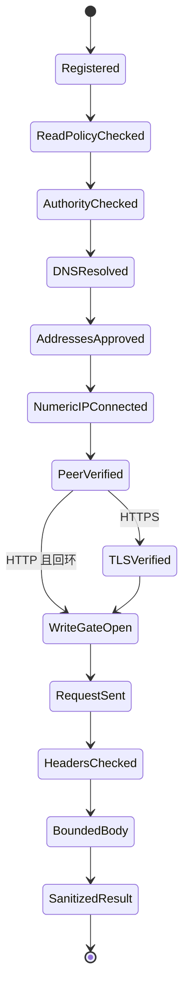

# 安全架构、网络边界与双层脱敏规格书

## 1. Agentic 与 MCP 威胁矩阵（Threat Matrix）

**状态：本文包含完整安全目标，当前实现是其中的回环子集。** 已实现固定 GET、DNS 全组回环验证、数字 IP 建连与 peer 校验、默认 TLS 验证、禁用代理/重定向、目标绑定的 Bearer、双层脱敏、调用/回包预算、32 KiB 响应头预算及单层 gzip 有界解压；远程白名单、Basic、其他压缩编码与真实 TLS/SNI 矩阵仍未交付。此前证据见[修复验收报告](../audits/comprehensive-remediation-2026-10-22.md)，本轮补充见[版本记录](../../CHANGELOG.md)。本文细化 [SPEC.md](../../SPEC.md)，沿用 [ADR 0001](../adr/0001-positioning-and-non-goals.md) 的永久非目标。MUST 表示强制要求；拒绝时不得降级绕过。伪代码中的完整类型和步骤不能直接当作当前已实现接口。

2026-10-30：连接器在解析期间累计状态行、临时响应及最终响应头的字节数，上限 32 KiB。收到响应头后，对策略拒绝的 HTTP 状态或不支持的 Content-Type 立即结束读取并关闭连接；健康端点的有效 503 JSON 仍读取。Content-Encoding 支持缺省、identity 和单层 gzip；gzip 对编码体与解码体分别计数，损坏、截断、尾部数据和多成员均拒绝，其他编码与编码链在正文读取前拒绝。

已解析地址的多次 socket 连接尝试共用 2 秒上限和原调用截止时间；连接成功后使用剩余读取时限。操作系统域名解析调用本身不能由 Python 强制终止，整体调用仍受原截止时间约束。Content-Length 尚未收满时返回 `INCOMPLETE_RESPONSE`，不把已读到的 JSON 片段视为完整响应。

产品默认采用直接 STDIO 通信，不开放 HTTP MCP 端口，不充当 OAuth 代理。目标注册表、端点策略、凭据绑定和本地规则属于可信控制面；MCP 参数、目标响应、DNS 结果及导入的证据均须校验。目标有权提供诊断数据，无权扩展访问范围或改变安全规则。部署信任边界包含本机操作系统、TLS 信任库及操作者批准的启动配置；本服务不能保护已被攻击者控制的宿主进程。

| 攻击入口与威胁 | 受损资产或错误行为 | 必须执行的控制 | 拒绝位置与主要验收编号 |
| --- | --- | --- | --- |
| 工具传入 URL、未知 targetId、authority 或路径注入 | 内网扫描、向错误服务发送凭据 | 只选择不可变注册表中的实例 ID；固定逻辑端点构造路径；拒绝未知输入字段 | 联网前，N01、E01 |
| DNS Rebinding、解析与连接之间的 TOCTOU | 检查公开 IP，却连接元数据或其他内网服务 | 校验全部解析结果；连接数字 IP；请求写出前核对真实 peer；不二次解析原域名 | socket/写入守卫，N02–N05 |
| IPv4-mapped IPv6、整数/八进制/十六进制 IP | 绕过基于字符串的地址判断 | 严格解析与规范化，再执行固定地址策略；拒绝非规范数值主机 | 注册与 DNS 校验，N06–N08 |
| HTTP 重定向、OpenAPI servers/$ref、认证发现 URL | 获准目标充当下一跳访问跳板 | 禁止重定向和远程引用；不执行认证发现；不请求响应提供的 URL | 端点与响应守卫，N09、E05 |
| 写操作、startup POST、堆或日志全量读取 | 修改目标、消耗证据、泄露全量内存和日志 | GET/HEAD 方法守卫、固定白名单、永久黑名单；黑名单优先 | 传输入口，E02–E04 |
| MCP 令牌透传与 Actuator 凭据回显 | 混淆授权边界、泄露 Basic/Bearer 凭据 | 不接收工具凭据；凭据只绑定一个目标；日志、错误和输出禁止回显 | 输入、认证与统一出口，L01、L09 |
| configprops inputs/origin、资源路径、连接串、嵌套 JSON | 脱敏顶层字段后仍通过间接路径泄露 | 上下文敏感性传播、结构化投影、连接串解析、高危值与已知凭据匹配 | 脱敏与序列化，L02–L08 |
| description/comments/异常中的提示词注入 | 诱导 Agent 扩权、访问其他工具或泄露信息 | 默认不输出原始自由文本；规则生成建议；目标文本不能控制权限和后续请求 | 分析器及出口，I01–I04 |
| 超大 body、压缩膨胀、恶意深度、慢速传输 | 内存/CPU/上下文耗尽 | 流式双计数、受限解压、解析/遍历限额、绝对时限及最终回包预算 | 读取至序列化各层，B01–B05 |

MCP 的 Token Passthrough 指接受并转发未正确面向本 MCP Server 验证的客户端令牌；将本地 Actuator 凭据写入日志则是另一条泄露路径。本产品不接收 MCP 参数中的认证材料，也不把上游客户端认证当作 Actuator 认证。MCP 安全指南中的 OAuth URL 防护在此用于说明 SSRF 机制；本产品访问获准回环/私网诊断目标时采用下文的显式登记策略。[MCP 2026-07-28 安全最佳实践](https://modelcontextprotocol.io/docs/2026-07-28/tutorials/security/security_best_practices)。

## 2. 防 SSRF 网络守卫与连接器强约束（Network Guard & Anti-SSRF State Machine）

### 2.1 注册表与地址策略

启动时校验并冻结 RegisteredTarget。工具输入只接受 targetId；禁止 url、host、port、proxy、headers、credential、followRedirects 等网络控制参数。路由诊断的 path 仅是本地匹配条件，不能进入 HTTP 请求构造器。

```python
@dataclass(frozen=True)
class RegisteredTarget:
    target_id: str
    scheme: Literal["http", "https"]
    hostname: str                 # 规范 IP 或 ASCII IDNA 主机
    port: int
    allowed_networks: tuple[IPNetwork, ...]
    actuator_segments: tuple[str, ...]
    enabled_endpoint_ids: frozenset[str]
    credential_ref: CredentialRef | None
    policy_version: str

@dataclass(frozen=True)
class ReadPermit:
    target: RegisteredTarget
    endpoint_id: str
    method: Literal["GET", "HEAD"]
    request_path: str             # 由固定模板构造的规范路径

@dataclass(frozen=True)
class ConnectPermit:
    read_permit: ReadPermit
    approved_addresses: tuple[IPAddress, ...]
    deadline: float              # 单次使用；绑定当前操作
```

这些类型只由内部注册表和守卫创建；不可从客户端 JSON 反序列化 Permit。配置变更需要重建注册表及客户端，不能通过工具热更新 authority、地址范围、凭据或能力。HTTP 目标的 allowed_networks 必须全部为回环范围的子网；域名解析和实际连接还须再次确认回环，不能仅凭配置名为 local 放行。

authority 解析必须满足以下顺序：拒绝空白、控制字符、反斜杠、百分号编码主机、userinfo、fragment、query 和不支持的 scheme；解析端口；使用严格 IP 解析器识别字面地址；其他主机按同一 IDNA 实现规范化、转小写并去掉单个末尾根点。空标签、通配主机和非法 DNS 标签拒绝。原输入与 HTTP 库解析得到的 authority 必须一致。

仅接受四段十进制、无前导零的 IPv4，以及严格 IPv6 字面量。`127.1`、`0177.0.0.1`、`0x7f000001`、`2130706433` 等即使可被系统解析，也必须在 DNS 调用前拒绝；不能把它们当普通域名交给系统解析。IPv6 zone ID，包括 `%eth0` 与 `%25eth0`，一律拒绝。IPv4-mapped IPv6 使用 `ipv4_mapped` 得到有效 IPv4 后再校验，不能按表面 IPv6 前缀放行。

| 地址类别 | 强制策略 |
| --- | --- |
| 回环 IPv4/IPv6 | 仅允许登记 authority/port；有效地址必须为回环，localhost 的全部解析结果也必须如此。允许 HTTP 或 HTTPS；HTTP 凭据仅在该回环边界内发送。 |
| RFC1918 IPv4、ULA IPv6、公开单播地址 | 仅允许明确登记的 HTTPS authority、端口与非空地址白名单；每个 IP 必须位于对应目标的批准范围。私网不是默认获准，也不是一律禁止。 |
| 全局地址授权 | 禁止 `0.0.0.0/0`、`::/0`、通配主机及“允许所有私网”开关。使用固定 IP 或操作者批准的有限网段。 |
| 永久拒绝地址 | 链路本地 `169.254.0.0/16`、`fe80::/10`；CGNAT `100.64.0.0/10`；未指定、广播、组播、保留/文档/基准地址；云平台特殊地址 `168.63.129.16`、`fd00:ec2::254`。拒绝优先于配置。 |
| 转换与隧道地址 | 首版拒绝 IPv4-compatible IPv6（`::1` 除外）、NAT64 `64:ff9b::/96`/`64:ff9b:1::/48`、6to4 `2002::/16`、Teredo `2001::/32`；不尝试用未验证的转换规则扩大范围。 |

地址分类必须使用显式网段表及严格解析器；不能只依赖可能跨 Python 版本变化的 `is_private`/`is_global`。首版静态规则如下，维护时以 IANA 注册表审阅变更，不能运行时下载规则来自动扩大权限。

| 地址族 | 固定分类顺序 |
| --- | --- |
| IPv4 | 永久拒绝 `0.0.0.0/8`、`100.64.0.0/10`、`169.254.0.0/16`、`192.0.0.0/24`、`192.0.2.0/24`、`192.88.99.0/24`、`198.18.0.0/15`、`198.51.100.0/24`、`203.0.113.0/24`、`224.0.0.0/4`、`240.0.0.0/4` 及云特殊地址；`127.0.0.0/8` 为受登记限制的回环；RFC1918 为受登记限制的私网；剩余地址也必须匹配目标批准范围。 |
| IPv6 | 先处理 mapped IPv4，再单独识别 `::1/128`；永久拒绝 `::/96`、`64:ff9b::/96`、`64:ff9b:1::/48`、`100::/64`、`2001::/23`、`2001:db8::/32`、`2002::/16`、`3fff::/20`、`fe80::/10`、`fec0::/10`、`ff00::/8` 及云特殊地址；其余仅接受受登记限制的 `fc00::/7` 和 `2000::/3`，未覆盖的地址类别拒绝。 |

IPv6 的 `::/96` 拒绝规则不覆盖已先转换并按 IPv4 校验的 mapped 地址。`2001::/23` 等保守拒绝是本产品策略，不表示其中所有地址具有相同的 IANA 用途。云特殊地址独立执行，即使操作者批准了对应 ULA/公网网段也不得放行。[IANA IPv4 特殊用途地址](https://www.iana.org/assignments/iana-ipv4-special-registry)、[IANA IPv6 特殊用途地址](https://www.iana.org/assignments/iana-ipv6-special-registry)、[AWS 元数据地址](https://docs.aws.amazon.com/AWSEC2/latest/UserGuide/instancedata-data-retrieval.html)、[Azure 平台特殊地址](https://learn.microsoft.com/en-us/azure/virtual-network/what-is-ip-address-168-63-129-16)。

### 2.2 状态机与发送门禁



图中每个非终态都可以因下表中的失败进入 CLOSED；没有从 CLOSED 到请求发送的转移。

| 状态 | 必须完成的检查及允许动作 | 失败行为 |
| --- | --- | --- |
| Registered | targetId 存在；配置与凭据引用有效；不输出秘密 | `UNKNOWN_TARGET`/`CONFIG_INVALID`；零网络请求 |
| ReadPolicyChecked | 第 3 节方法、黑名单、能力、模板及参数检查 | 对应拒绝代码；不解析目标 DNS |
| AuthorityChecked | 规范 authority 与注册值完全相同；非回环策略只允许 HTTPS | `AUTHORITY_DENIED`/`HTTPS_REQUIRED` |
| DNSResolved | IP 字面量直接使用；域名在本次操作内解析所有 A/AAAA，最多 16 个地址 | 解析失败或超量拒绝；不输出完整解析列表 |
| AddressesApproved | 规范化每个地址，执行永久拒绝与目标范围检查；任一结果不合格则整组拒绝 | `ADDRESS_DENIED`；不能只筛掉坏地址后继续 |
| NumericIPConnected | 只连接本组数字 IP 的一个地址，端口固定；连接器不得重新解析原 hostname | 不可达候选可在同一截止时间内尝试其他已批准候选；不可回退其他目标 |
| PeerVerified | 立即读取 `getpeername()`，规范化并比对选中的 IP/port 和目标策略；此时尚未写出应用 HTTP 字节 | `PEER_MISMATCH`/`PEER_UNAVAILABLE`；立即关闭，不尝试用认证探测 |
| TLSVerified | 证书链、有效期及原注册主机名/IP 身份通过；SNI/Host 使用原 authority，不使用替换的连接 IP 冒充主机名 | `TLS_VERIFICATION_FAILED`；不重试关闭验证 |
| WriteGateOpen | 每次 HTTP write 均要求连接状态及 Permit 有效；认证头绑定同一目标 | `WRITE_GATE_CLOSED`；不写请求、body 或认证头 |
| HeadersChecked | 禁止下一跳、Upgrade 和异常编码；验证受限响应头、状态及内容类型 | 重定向为 `REDIRECT_BLOCKED`；不请求 Location，不读取其错误页面 |
| BoundedBody | 第 2.4 节编码体/解压体计数、绝对时限与解析限额 | 关闭流，返回安全错误；不解析残缺 JSON |
| SanitizedResult | 第 4、5 节投影、脱敏、Schema 和完整回包预算通过 | 安全 fallback；不回退原始响应 |

DNS 返回获准地址 A 后，连接过程只能使用数字 A。即使 DNS 随后返回 B，也不会改变该连接。实际 peer 必须等于 A；仅“peer 仍在某个大网段内”不够。TLS 必须在同一已验证 socket 上升级，不能由 TLS helper 重新建连。安全检查必须在发送任何 HTTP 请求前执行，而非收到 response 后检查 `response.extensions`。

### 2.3 HTTPX/HTTPCore 实现接口与认证边界

采用 `httpx.AsyncBaseTransport` 和 HTTPCore 的公共 `AsyncNetworkBackend`/`AsyncNetworkStream` 扩展点。后端负责数字 IP 连接和 peer 校验，流包装器负责写门禁，TLS 包装成功后保留已验证的连接身份。不能只包装默认 HTTPTransport 并在请求前执行一次 DNS 检查。[HTTPX 传输接口](https://www.python-httpx.org/advanced/transports/)、[HTTPCore 网络后端](https://www.encode.io/httpcore/network-backends/)。

```python
async def guarded_read(target_id, endpoint_id, selectors, method="GET"):
    read = authorize_read(target_id, endpoint_id, selectors, method)
    connect = await resolve_and_pin(read, absolute_deadline())
    stream = await connect_numeric(connect)  # 无 hostname 二次解析
    try:
        verify_actual_peer(stream, connect)  # 必须在 start_tls / HTTP write 前
        if read.target.scheme == "https":
            stream = await start_verified_tls(
                stream, server_identity=read.target.hostname,
                ssl_context=verified_context(),
            )
        else:
            require_effective_loopback(connect)
        verified = open_write_gate(stream, connect)
        # 认证头可在内存构造；只在 peer/TLS 检查通过后允许写出。
        headers = fixed_headers_and_bound_auth(read.target)
        response = await send_http11(verified, read, headers, body=None)
        check_response_headers(response)
        return await read_decode_and_parse_bounded(response)
    finally:
        await close_without_raw_error_logging(stream)
```

实际实现须通过 HTTPCore 的 HTTP framing 发送请求，不能把上述 `send_http11` 变成手写、不校验的 HTTP 协议实现。连接、TLS、取消及所有失败分支的清理都必须在明确的 try/finally 或上下文管理器中。

| 客户端选项或行为 | 固定约束 |
| --- | --- |
| 重定向 | HTTPX `follow_redirects=False`（策略名 followRedirects=false）；传输守卫再次拒绝 301/302/303/307/308。其他 3xx 不触发额外请求。 |
| 方法和协议 | 仅 GET/HEAD；HTTP/1.1；禁用 HTTP/2、keep-alive、协议 Upgrade、CONNECT 和方法覆盖头。首次实现使用每次请求独立连接。 |
| 代理与扩展 | `trust_env=False`，自定义 transport 不配置代理；不接受客户端指定 proxy、UDS、SNI、Host 或低层 target 扩展。 |
| TLS | SSLContext 在自定义 transport/HTTPCore 中明确配置并强制证书/身份验证；无 verify=false、insecure 或远程 HTTP 例外。不能仅给 AsyncClient 传 verify=True 就认定自定义 transport 已安全。 |
| Cookie | 不保留或发送 Cookie；不把 Set-Cookie 暴露给客户端或后续请求。不能依赖默认 CookieJar 恰好为空。 |
| 认证 | 仅从该目标的环境变量绑定构造 Basic/Bearer/批准的自定义认证头；不使用 netrc、响应中的挑战 URL或自动 OAuth 发现。 |
| 请求头 | Host、Accept 等由服务生成；自定义认证头不能覆盖 Host、Cookie、Content-Length、Transfer-Encoding、代理或方法控制字段。拒绝 CR/LF。 |
| 日志 | 关闭 HTTP 库的原始请求/响应调试输出和第三方 body tracing；不记录 Authorization、完整 URL、响应头或 exception repr。 |
| 重试 | 禁用底层隐式重试；仅由统一调度器允许一次短暂连接/读取错误重试，并重新执行整条状态机。策略、TLS、peer、授权和解析错误不重试。 |

HTTPCore 可通过网络流读取 server_addr；本实现必须在连接器中取得相同含义的实际 socket 地址。无法取得地址的后端不具备生产使用资格，不能只靠 request URL 代替。[HTTPCore 网络流信息](https://www.encode.io/httpcore/extensions/)。

### 2.4 读取、解压与错误预算

继承 SPEC：connect 2 秒，单请求读取绝对时限 5 秒（含连接/TLS），单工具总时限 15 秒；每目标最多 2 个并发请求；上游默认 8 MiB、硬上限 16 MiB；最终完整 JSON-RPC 回包最多 16,384 UTF-8 字节。不能把示例中的“10MB 熔断”作为另一个未定义默认值。

请求默认发送 `Accept-Encoding: identity`。若目标仍返回 gzip，只接受单层 gzip 并用受限增量解压处理；其他编码或编码链返回 `UNSUPPORTED_CONTENT_ENCODING`。原始内容使用 `aiter_raw()` 或等效未自动解压的流读取，同时累计 encodedBytes 与 decodedBytes。禁止先 `response.content`/无界 `aread()`，也禁止用自动解压后的计数冒充编码体计数。

```python
async for chunk in response.aiter_raw():
    check_deadline()
    encoded_bytes += len(chunk)
    require(encoded_bytes <= upstream_limit)
    # gzip 每次最多产生 remaining + 1 字节；处理 unconsumed_tail 时也受限。
    for decoded in bounded_decode(chunk, remaining=upstream_limit-decoded_bytes):
        decoded_bytes += len(decoded)
        require(decoded_bytes <= upstream_limit)
        parser.feed(decoded)  # 解析过程中执行节点/深度限额
finish_decoder_and_parser_with_same_limits()
```

Content-Length 超限可提前拒绝；缺失、错误或 chunked 情况仍必须流式计数。gzip 结束、校验和、尾部及重复成员必须验证；拒绝多成员、损坏或未完成流。不能无界 flush 解压器。JSON 最大深度 64、节点 100,000，分析遍历 20,000；拒绝重复对象键、非标准 NaN/Infinity 和无效 UTF-8。超限结果不带原始 body。响应头总预算为 32 KiB，在 framing 解析期间实施，不能构造完无限头部后再判断。

HEAD 结果不按 JSON body 解析；若与 framing 不符，关闭连接。健康端点的有效 503 JSON 可按已注册健康语义处理，不能全局 `raise_for_status()` 后回显异常。客户端取消会取消连接/读取/分析任务并释放临时数据。任何拒绝均返回固定错误代码、端点 ID和本地维护者建议；不返回 DNS 全表、证书全文、Location 或原始 exception。

### 2.5 网络验收用例

测试使用可注入 resolver、连接器和记录写入次数的假网络流；除受控回环集成用例外，不实际访问表中地址。

| 编号 | 输入或模拟行为 | 必须断言 |
| --- | --- | --- |
| N01 | 未登记 targetId；工具尝试增加 url/headers/proxy 参数 | 输入拒绝；DNS、连接和请求计数均为 0 |
| N02 | DNS 首次返回批准地址，之后返回 `169.254.169.254` | 只对首次批准的数字 IP 建连；没有第二次 hostname 解析 |
| N03 | 解析批准 A，实际 socket peer 为 B，即使 B 也位于批准网段 | PEER_MISMATCH；HTTP write/认证头发送次数为 0 |
| N04 | DNS 同时返回允许地址与链路本地地址 | 整组 ADDRESS_DENIED；不能只连接允许的一个 |
| N05 | 后端不提供 peer 信息；Permit 失效或策略版本不符 | fail closed；没有应用请求写出 |
| N06 | `::ffff:169.254.169.254`、`::ffff:100.100.100.200` | 规范化后命中 IPv4 拒绝规则 |
| N07 | `::ffff:127.0.0.1` 与已登记回环 authority | 仅在有效 IPv4 回环、端口和 authority 均批准时可继续 |
| N08 | 八进制、十六进制、整数/缩写 IPv4、IPv6 zone ID、NAT64/6to4 | 注册或解析检查拒绝；不让系统尝试旧式地址解析 |
| N09 | 已批准目标返回相对或绝对 Location，指向相同目标、私网或元数据 | 均不跟随；下一跳请求计数为 0；不回显 Location |
| N10 | 私网/公网 HTTP；HTTPS 证书错误；连接 IP 与证书主机名不同 | 非回环 HTTP 拒绝；TLS 错误拒绝；正确 SNI/证书仍可通过数字 IP 连接 |
| N11 | 环境中设置 HTTP_PROXY/HTTPS_PROXY、netrc；响应设置 Cookie | 不经代理、不加载 netrc、不发送 Cookie、不跨目标复用凭据 |
| N12 | 在连接、TLS、读取或重试时取消；模拟慢速分块 | 资源关闭、任务停止；绝对时限不被分块或重试重置 |

## 3. 端点级白名单与黑名单硬编码策略（Endpoint Allowlist & Hard Blocklist）

### 3.1 只读守卫的判定顺序

```python
def authorize_read(target_id, endpoint_id, selectors, method):
    target = registry.require_existing(target_id)
    require(method in {"GET", "HEAD"}, "METHOD_DENIED")
    definition = BUILTIN_ENDPOINTS.require(endpoint_id)
    reject_hard_blocked_family(definition)  # 配置不能覆盖
    require(definition.capability in target.enabled_endpoint_ids,
            "CAPABILITY_DISABLED")
    path = definition.build_from_validated_selectors(target, selectors)
    require_canonical_path_matches_definition(path, definition, target)
    return internal_read_permit(target, definition, method, path)
```

首次实现的 MCP 诊断使用 GET。HEAD 仅能用于已批准端点的显式内部读取，不得用来自动扫描端点。目标拒绝 GET/HEAD 时返回能力问题，不推测替代方法。启动配置不能注册任意 URL 或任意 endpoint definition；配置只选择内建能力和经过校验的固定文档/管理基路径。

### 3.2 内建端点和永久拒绝

| 逻辑端点/路径族 | 状态 | 数据与请求边界 |
| --- | --- | --- |
| health、beans、mappings、flyway、liquibase | 默认能力 | 固定管理基路径下的固定 GET；Bean/路由过滤在本地执行 |
| conditions、startup | 显式启用 | 固定读取；startup 永远不允许 POST，即使 GET 不存在 |
| health/liveness、health/readiness | 显式启用 | 仅两个预注册健康组；component/group 不能生成任意后缀 |
| openapi | 显式启用 | 启动时冻结最多三个同 targetId/authority 文档路径；仅 404 在登记集合内回退；不访问 UI、servers 或外部引用 |
| info | 显式启用 | 仅投影批准的 build/git 标识字段；丢弃任意自定义 info 内容 |
| env-property | 显式启用且逐属性登记 | 只允许安全键名、类型和值域的单属性路径；返回实际 Profile、批准的有效值及来源类别 |
| env、configprops | 默认关闭，显式授权后受控 GET | 仅固定端点及经过验证的前缀/单属性模板；与登记的安全属性/前缀取交集，双层脱敏后投影；禁止完整原始值树出站 |
| quartz | 永久禁止读取 | 包含子路径，不因配置诊断而开放 |
| heapdump、logfile | 永久禁止读取 | 包含 GET/HEAD 和子路径；不能以范围请求、下载链接或导出绕过 |
| shutdown、任何目标写操作 | 永久禁止 | POST/PUT/PATCH/DELETE/CONNECT 等在方法检查阶段即拒绝 |
| loggers、caches 的读取 | 不在现有白名单 | 不能因 GET 看起来只读便注册；写入/清理无条件禁止 |
| 其他 Actuator、自定义或业务端点 | 默认拒绝 | 请求受控读取新能力需变更规格和内建定义，不允许透传 |

OpenAPI auto 模式的候选顺序为操作者配置的 customPath（若有）、`/v3/api-docs`、`<actuatorBase>/openapi`；application 模式仅前两项，management 模式仅管理路径并忽略 customPath。路径先去重并逐一完成注册校验；不从响应、env/configprops、工具参数或 UI 发现新路径。401/403、重定向、非法文档、其他错误或预算耗尽立即停止；不同端口必须独立登记目标，不能自动切换 authority 或跨目标转发凭据。每个请求都重新经过连接守卫；完整规则见[跨版本归一化设计第 3.4 节](cross-version-normalization.md#34-openapi-自定义路径与管理端口回退)。

管理基路径只由启动配置的安全段构成。与拒绝规则比较的是逻辑端点身份和已规范化的模板，而不是只比较字面 `/actuator` 前缀。拒绝 `.`/`..`、空段、反斜杠、分号矩阵参数、编码斜杠/点段、双重编码和 control characters；模板参数不能注入 query 或 fragment。允许的单属性键只来自精确登记项，包含点号不等于允许路径点段。

配置诊断是契约版本 2 新增能力，替代早期 env/configprops 网络读取禁令。能力默认关闭，优先已验证的 configprops/{prefix}、env/{property.name}；固定全端点响应仍受上游字节限制，只有脱敏后的登记字段可出站。includeValues 默认 false；开启也不能恢复秘密或要求 show-values=always。origin 仅输出安全相对文件/行列号或环境变量名，不保留完整自由文本。quartz 仍禁止；完整规则见[调用策略](../contracts/tool-calling-policy.md)。

| 编号 | 拒绝用例 | 必须断言 |
| --- | --- | --- |
| E01 | 路由 path=`http://169.254.169.254/`；selectors 含网络控制字段 | 输入拒绝；不形成请求 URL，DNS/连接次数均为 0 |
| E02 | POST shutdown/loggers/startup、DELETE caches；方法覆盖头 | METHOD_DENIED；无 DNS 或连接；配置白名单无法覆盖 |
| E03 | GET/HEAD heapdump、logfile、quartz；未授权 env/configprops | ENDPOINT_BLOCKED；不读取 body，也不生成下载链接 |
| E04 | 更换管理前缀、大小写/编码/路径穿越/双重编码变体 | 规范路径拒绝；不能绕过逻辑端点身份与模板 |
| E05 | OpenAPI 远程/file `$ref`、servers、WWW-Authenticate 中的发现 URL | 不发二次请求，不执行 Shell，返回固定 unsupported/blocked 原因 |
| E06 | env-property 选择秘密键、未登记键或包含路径语法的键 | 参数/策略拒绝；不扩大到未登记的全量字段 |

## 4. 双层敏感数据脱敏管道规范（Dual-Layer Sanitization Pipeline）

### 4.1 两层职责与结构化输出默认值

第一层为目标端已有的最小暴露、认证授权及适用端点的值屏蔽。不同 Boot 版本和 show-values 设置的保护范围不同；不得要求将目标改为 always，也不得因为看到 `******` 就信任整个响应。第二层由 MCP Server 独立执行，覆盖允许读取中的健康 details、条件消息、资源路径、迁移记录、OpenAPI 数据和异常。目标端屏蔽不能替代第二层。[Spring Boot 敏感值处理](https://docs.spring.io/spring-boot/reference/actuator/endpoints.html)。

生产默认仅返回字段白名单中的结构化值。description、comments、example、任意异常 message/stack trace 及未结构化条件消息不出站；分析器可以在受限内存中提取批准的事实和错误类型。`includeDetails=true` 只请求更多批准的结构化事实，不能恢复自由文本；本版本不提供关闭投影、脱敏或返回原文的参数。

```text
BoundedBody / 严格 JSON
  → 内部类型化提取与有限原文分析
  → schema 白名单投影及 origin/resource 归一化
  → 上下文敏感性传播
  → 连接串、嵌套 JSON 与高危值处理
  → 已知凭据字面匹配
  → 安全标记位置元数据
  → 输出 Schema 验证
  → 分页与完整 JSON-RPC 预算
```

原始 JSON、临时解析视图和凭据只存在于受限处理周期，不入快照缓存、日志、异常、repr 或导出。缓存只接受最终脱敏结构。模型、工具注解及“忽略恶意指令”提示不参与安全判断。

### 4.2 键名规则和传递敏感性

匹配视图为 `NFKC(key).casefold()` 去除非 ASCII 字母数字后的结果；正则在此视图上 search。归一化只用于检测，不修改迁移版本、checksum 或业务标识。固定输出字段由 Schema 枚举；未知动态键不能因正则未命中而获准输出。对动态属性 name/key/propertyName 同样构造检测视图。

以下规则为完整的基础键名族，忽略大小写；宁可过度脱敏，不能只使用结尾等于 password 的判断：

| 规则 ID | 规范化键名匹配式 | 包含的间接命名 |
| --- | --- | --- |
| K01 | `password\|passwd\|pwd` | dbPassword、spring.datasource.password |
| K02 | `secret` | clientSecret、OAuth Client Secret、secretAccessKey |
| K03 | `token` | apiToken、access_token、refreshToken、idToken、sessionToken |
| K04 | `apikey\|accesskey` | API_KEY、accessKeyId、AWS_ACCESS_KEY_ID |
| K05 | `authorization\|credential` | Proxy-Authorization、credentials、认证描述对象 |
| K06 | `cookie\|sessionid` | Set-Cookie、JSESSIONID、session-id |
| K07 | `privatekey\|signingkey\|passphrase\|keystorepassword\|truststorepassword` | PEM 配置、密钥库口令、签名私钥 |

```python
MARKER = "[REDACTED_BY_MCP]"
KEY_RE = re.compile(
    r"(?:password|passwd|pwd|secret|token|apikey|accesskey|authorization|"
    r"credential|cookie|sessionid|privatekey|signingkey|passphrase|"
    r"keystorepassword|truststorepassword)",
    re.IGNORECASE | re.ASCII,
)

def sensitive_key(key: str) -> bool:
    view = unicodedata.normalize("NFKC", key).casefold()
    view = re.sub(r"[^a-z0-9]", "", view, flags=re.ASCII)
    return KEY_RE.search(view) is not None
```

敏感性传播使用双遍遍历或等价上下文算法，不能仅对每个叶子做独立正则：

1. 动态 map 键或描述字段 name/key/propertyName 命中时，关联属性值与输入来源整组标为 tainted。
2. `inputs.<property>.value` 与 `inputs.<property>.origin` 共享属性上下文；敏感属性的 origin 同样替换，不能只遮蔽 value。prefix/beanId 影响完整属性名时须一起判断。
3. `{name: "clientSecret", value: ..., origin: ...}` 及列表中的等价对象遵循相同规则。已 tainted 的子树可整体替换；不得从原文派生摘要、前后缀或可逆编码再输出。
4. origin/resource 即使属性名不敏感，也进入连接串/赋值检测；绝对用户路径、jar/file URL、查询串及括号内参数不能直接进入公开 resource 字段。默认只保留校验后的资源种类和允许的相对资源标识，无法安全归一化则省略。

动态 JSON 键本身也可能是秘密或指令。先把获准的动态项转为带安全字段名的记录数组；不安全的名称置为 MARKER 或省略，不以原始键名构造公开 JSON Pointer、日志或 redactions。内部定位使用序号；公开路径只包含固定 Schema 字段及数组索引。

### 4.3 连接串解析与剥离

连接串检测适用于独立值和 resource/origin/异常中嵌入的片段；不得为了验证连接串而解析 DNS 或建立连接。URI/赋值模式只负责定位候选，安全决策来自对应的受限解析器。

| 输入族 | 解析和替换规则 |
| --- | --- |
| URI 形式 JDBC，例如 PostgreSQL/MySQL | 移除 `jdbc:` 后按批准驱动的 URI grammar 解析；不以第一个冒号或 @ 随意分割。userinfo 整体剥离，敏感性不取决于用户名是否为空。 |
| Redis、rediss、AMQP、amqps、MongoDB、mongodb+srv | 按协议 authority grammar 解析用户信息、IPv6、端口及 MongoDB 多主机；默认拒绝输出数据库路径和认证相关参数值。 |
| HTTP(S) URL 出现在数据值中 | 仅作为数据解析，不请求；移除 userinfo，query/fragment 不原样输出。 |
| `password=`、`secret=`、`accessKey=` 及同族参数 | 逐项解析，检查所有重复参数；参数名按规范化键规则判断。包括 JDBC 支持的分号属性。默认所有连接参数值都标记，只有 Schema 明确批准的有限非敏感类型/值域可保留。 |
| 转义与多重编码 | 使用有界解析视图，最多两层百分号解码；不改变原值后再假装其语义未变。残余编码、边界不确定、缺失引号或不支持语法时整值标记。不能按 `&`/`;` 盲切带引号或转义的口令。 |
| 非 URI JDBC、Oracle thin、SQL Server 复杂属性等未实现 grammar | 整个字段或候选所在自由文本替换为 MARKER；不能猜测保留某段内容。 |

连接字段只允许输出以下结构的批准子集，不构造可执行或可点击的“脱敏 URL”：

```json
{
  "kind": "connection",
  "scheme": "postgresql",
  "host": "db.example.test",
  "port": 5432,
  "credentials": "[REDACTED_BY_MCP]",
  "database": "[REDACTED_BY_MCP]",
  "parameters": "[REDACTED_BY_MCP]"
}
```

host/port 只有在对应输出 Schema 明确允许时才保留，且仍经过值检测；多主机转换为同样受条数/字节预算限制的结构化列表。原始 URI、用户名、参数值和 fragment 不附在旁路字段。嵌入自由文本的连接串整叶替换，不保留周围可能包含另一份凭据的文本。

### 4.4 高危值正则、嵌套 JSON 与已知凭据

以下为 Python re 的候选检测式。执行前每个扫描字符串最多 64 KiB UTF-8；超限整叶标记，不保留前缀。模式不能被用作“未命中即安全”的自由文本放行器。具体编译 flags 与后续动作属于规则的一部分。

| 规则 ID | 模式常量 | 强制后续动作 |
| --- | --- | --- |
| V01 | AUTH_RE | 发现 Bearer/Basic 候选则整叶标记，不只删除已匹配的一段 token。Authorization/Cookie 键直接由 K 规则处理。 |
| V02 | JOSE_RE | 检查 3 或 5 段；第一段在 4 KiB 上限内 Base64URL 解码并严格解析为 JSON object，符合 JOSE 结构则整叶标记；候选超预算同样整叶标记。不验证签名、不依赖 eyJ 前缀。 |
| V03 | PEM_RE、PEM_BEGIN_RE | 完整私钥或存在 BEGIN 而缺失/损坏 END，均整叶标记；包括 literal 换行与内嵌 JSON 解码后的换行。 |
| V04 | URI_START_RE | 交第 4.3 节解析；不支持或歧义时整叶标记。 |
| V05 | ASSIGNMENT_RE | 对每个候选 key 执行 sensitive_key；命中则整叶标记，避免错误猜测带引号/分隔符的秘密结束位置。 |
| V06 | 本地凭据字面值集合 | 对运行态字符串做大小写敏感、非正则的字面匹配；命中整叶标记。覆盖用户名、密码、Bearer、完整 Basic 编码和受控编码形式。 |

```python
AUTH_RE = re.compile(
    r"(?<![A-Za-z0-9_])(?:Bearer|Basic)[ \t]+[A-Za-z0-9._~+/=-]+",
    re.IGNORECASE | re.ASCII,
)
JOSE_RE = re.compile(
    r"(?<![A-Za-z0-9_.-])[A-Za-z0-9_-]+"
    r"(?:\.[A-Za-z0-9_-]*){2,4}(?![A-Za-z0-9_.-])",
    re.ASCII,
)
PEM_RE = re.compile(
    r"-----BEGIN (?P<kind>(?:RSA |EC |DSA |OPENSSH |ENCRYPTED )?PRIVATE KEY)-----"
    r".*?-----END (?P=kind)-----", re.DOTALL | re.ASCII,
)
PEM_BEGIN_RE = re.compile(
    r"-----BEGIN (?:RSA |EC |DSA |OPENSSH |ENCRYPTED )?PRIVATE KEY\b",
    re.ASCII,
)
URI_START_RE = re.compile(
    r"(?:jdbc:[a-z][a-z0-9+.-]*:|(?:https?|rediss?|mongodb(?:\+srv)?|amqps?)://)",
    re.IGNORECASE | re.ASCII,
)
ASSIGNMENT_RE = re.compile(
    r"(?P<key>[A-Za-z][A-Za-z0-9_.-]{0,127})[ \t]*[:=][ \t]*",
    re.ASCII,
)
```

JWT/JWE 只按结构检测并遮蔽，不将它当身份材料验证或转发；opaque token 没有通用可识别格式，依靠字段白名单、键名/上下文、已知凭据集合和禁止原始自由文本输出约束，而不是宣称正则能识别所有秘密。

PEM_BEGIN_RE 命中后即可整叶标记，不必在请求路径继续运行完整 PEM_RE。完整块模式用于受限分类和 fixture 校验；不能因 BEGIN 无对应 END 而放行，也不能用重复尝试完整块匹配耗尽分析预算。其余模式仅在上述字符串长度和原请求时限内执行，禁止新增带嵌套重复或未经审查的用户正则。

凭据集合在启动或明确的凭据重载时由环境变量绑定构建，不扫描所有环境变量。只生成原文、UTF-8 Basic 的 Base64(user:password)、URL 百分号编码以及必要 JSON 转义等固定变体，不做任意组合或暴力解码。变体使用字面匹配；若实现用正则组合，必须先 re.escape。凭据最长 8 KiB、每目标最多 32 个固定变体，超限拒绝配置；短凭据可能造成过度脱敏，不能因此放松检查。集合不进入工具 Schema、日志或缓存。

JSON 字符串若在去空白后以 `{`/`[` 开始，允许在最多 4 层嵌入、单字符串 64 KiB、共享节点预算内严格解析；拒绝重复键、NaN/Infinity。递归脱敏后用确定性 JSON serializer 返回字符串，不能不经 Schema 就把它变成对象。候选无法解析或超限时整叶标记。先处理嵌套结构再处理整叶高危模式，避免泄露其中的 value/origin。

### 4.5 幂等性、JSON 合法性与统一出口

```python
def sanitize_json(value: JSONValue, context: SensitivityContext) -> JSONValue:
    """纯函数；对相同策略要求 S(S(x)) == S(x)。"""
    if context.tainted:
        return MARKER
    if isinstance(value, dict):
        taints = classify_property_contexts(value, context)  # 先识别关联关系
        return sanitize_allowed_fields(value, taints)       # 未知字段省略
    if isinstance(value, list):
        return [sanitize_json(item, context.child(i))
                for i, item in enumerate(value)]
    if isinstance(value, str):
        if value == MARKER:
            return MARKER
        if exceeds_string_budget(value):
            return MARKER
        if is_embedded_json_candidate(value):
            nested = parse_embedded_json(value, context.shared_budget)
            if nested is EMBEDDED_PARSE_FAILURE:
                return MARKER
            return stable_json(sanitize_json(nested, context.nested()))
        if has_high_risk_value_or_known_secret(value):
            return MARKER
        return validate_structured_string_or_omit(value, context.schema)
    return validate_typed_scalar_or_omit(value, context.schema)
```

伪代码中的 omit 与 EMBEDDED_PARSE_FAILURE 是内部哨兵，不是 JSON null；容器构造时移除 omit 项并记录完整性缺口。内嵌解析失败直接返回 MARKER，不能把 MARKER 再 JSON 编码成带引号的标记字符串。实际规范化/脱敏 helper 必须共享原请求的节点、深度与时限预算。

唯一的标记短路是 `value == MARKER`。`"[REDACTED_BY_MCP] Bearer ..."` 仍须检查并整叶标记。目标已屏蔽的值按不可观测数据处理，不参与实际值比较；固定目标掩码可归一为 MARKER，不推断原值。输出 Schema 接受字面 MARKER、合法类型或明确的缺失状态；不能把标记强行填入只允许数值的字段后继续宣布 Schema 成功。

禁止对已序列化 JSON 执行全局 re.sub；在结构树上替换并由 JSON serializer 处理引号、反斜杠、换行和 Unicode。完整 S 包含稳定投影与替换，不增加时间戳、不追加审计事件。`redactions` 从脱敏后 MARKER 的安全字段/索引位置重建，使用固定 reason=`redacted_value`，稳定排序并去重；详细规则命中仅在内部以固定规则 ID 计数，不把原始值、长度、哈希或不安全原始路径放入输出。因此再次运行 S 不丢失标记元数据，也不重复追加。

只有明确输入 Schema 的结构化字符串可原样保留；已标记值是输出 Schema 的独立字面分支，再次验证不能把它当非法业务名删除。内嵌 JSON 第二次解析后的确定性序列化必须字节一致。原始对象不得因带有伪造的 policyVersion、trust 或 alreadySanitized 字段跳过检查。

统一出口顺序为 `sanitize → validate_output → paginate/budget → serialize_full_rpc → check_16384_bytes`。合法 JSON、分页统计、覆盖范围和精确下一步必须保留；丢弃文本或敏感字段须记录 omission/可见性缺口，不能据此断言原始对象不存在或没有底层错误。无法安全输出时返回不含原文的最小失败结果。TextContent 的兼容 JSON 副本和 JSON-RPC 信封都计入预算。日志只允许固定事件代码、批准的 targetId/endpointId、耗时、状态和规则计数，不能用异常 format/repr 生成“脱敏日志”。

### 4.6 脱敏与预算验收

测试秘密必须为明确的合成 fixture，不使用真实凭据；每项都检查 MCP structuredContent、TextContent、日志、异常、缓存和导出出口。

| 编号 | 输入或性质 | 必须断言 |
| --- | --- | --- |
| L01 | Authorization/Proxy-Authorization、Basic/Bearer、Cookie、被目标回显的已知凭据 | 不出现原值/Basic 编码；认证材料不会因出错或重试进入输出 |
| L02 | configprops 中 inputs.*.value 与 origin 同时包含合成秘密；name/value 列表等价结构 | value 与 origin 共享敏感性；不能通过 origin 或 redactions 路径泄露 |
| L03 | beans resource、file/jar origin 的括号、userinfo、query、分号参数包含秘密 | 原始路径不出站；只保留批准的资源事实或 MARKER |
| L04 | JDBC/Redis/MongoDB/AMQP URI，含 IPv6、多主机、百分号转义、重复 password/secret/accessKey 参数 | 所有用户信息和秘密值均剥离；不支持 grammar 整值标记；没有 DNS/网络调用 |
| L05 | 三段 JWT、五段 JWE、非 eyJ 开头的有效 JOSE 头、PEM 六种类型及缺失 END | 均整叶标记；不把捕获到的一小段删除后返回剩余私钥 |
| L06 | JSON 字符串中的二阶/多阶 JSON、转义换行 PEM、无效或超限内嵌 JSON | 合法结果保留字符串类型；重复键/失败候选整叶标记 |
| L07 | MARKER、MARKER 后附秘密、伪造 sanitized/trust 字段 | 精确标记幂等；附加秘密仍被遮蔽；伪造字段不能跳过检查 |
| L08 | Unicode、引号、反斜杠、空容器、敏感非字符串子树；应用 S 两次 | 两次结果相同；JSON round-trip 与输出 Schema 均通过；元数据稳定 |
| L09 | exception repr、HTTP debug 日志、Set-Cookie、证书错误、带秘密的动态键名 | 所有出口只含安全字段；路径/日志/导出不存在旁路原值 |
| B01 | chunked/缺失或伪造 Content-Length；body 正好上限与多 1 字节 | 边界内可处理；超限停止流并关闭连接；不解析截断 JSON |
| B02 | gzip 小编码体膨胀、大解压尾块、多成员及损坏 gzip | 编码与解压计数独立；无界 flush/解压不发生；失败安全 |
| B03 | 慢速字节流、深度 65、节点超限、重复键、NaN、超长响应头 | 绝对超时/解析/头部限制生效；不分配完整无限对象 |
| B04 | 50 个大记录、中文/emoji、两份 MCP 内容、关联数组和错误 Recipe | 实测完整 JSON-RPC UTF-8 字节 ≤16,384；JSON 合法且含截断/覆盖/下一步 |
| B05 | 单记录无法容纳、Schema 验证失败、取消或缓存淘汰 | 最小安全失败或精确收窄建议；不回退原文，不拼接不一致快照 |

性质测试固定覆盖 `S(S(x)) == S(x)`、`json.loads(json.dumps(S(x))) == S(x)`、输入对象不被原地修改以及相同策略版本下稳定序列化。文档中的正则和示例应独立用标准库校验；这些校验不能替代实际 connector 的零写入断言或完整生产实现测试。

## 5. 间接提示词注入隔离与不可信文本封装规范（Untrusted Runtime Content Wrapping）

### 5.1 输出隔离与数据类型

服务不使用 LLM 判断文本是否恶意。生产默认不返回 OpenAPI description、迁移 comments、原始异常 message/stack trace 或条件报告原文。分析器在有界内存中提取 conditionType、operator、matched、异常类型、状态、路径和其他允许事实；未知/未支持结构返回 unknown，不粘贴原文作为证据替代。

结构化证据采用内部 RuntimeEvidence 类型，不增加额外公开工具或可控制的网络参数。对应公开 data.items 的证据部分使用以下形态，字段由服务构造而不是复制目标提供的 trust 标签：

```json
{
  "trust": "runtime_untrusted",
  "evidenceLevel": "observed",
  "source": {
    "endpointId": "conditions",
    "snapshotId": "example-snapshot",
    "observedAt": "2026-10-16T03:00:00Z"
  },
  "facts": {
    "conditionType": "OnBeanCondition",
    "operator": "all",
    "matched": false
  },
  "omissions": [
    {"field": "message", "reason": "unstructured_runtime_text"}
  ]
}
```

facts、source 和 omissions 使用固定字段与枚举；运行态业务标识按各工具 Schema 校验并仍执行脱敏。目标中的 toolName、role、system、instructions、trusted 或 policyVersion 不映射为控制字段。不可安全定位的原始 evidence path 用固定字段和数组索引表示，不回显恶意动态键。

`trust=runtime_untrusted` 是来源说明，不是让模型自行防御的机制。网络与执行保证由注册表、只读守卫、无原文输出和不可变策略实现。结构化值仍可能携带攻击者选择的语义；本服务不能保证客户端模型免疫，也不能限制客户端自行提供的 Shell、文件或其他工具。客户端对其他工具的隔离属于它自己的权限边界，不能被本文包装标签替代。

### 5.2 建议、错误与旁路输出

修复建议和 Remediation Recipe 只能由本地规则库根据固定错误代码与结构化事实生成，包含规则 ID、依据和明确缺失能力。远端 comments/message/description 不得提供 nextAction.tool、请求地址、Shell 命令或修改权限的理由。精确过滤建议只能引用本地八个工具及通过输入 Schema 校验的参数；不得嵌入远端文本生成命令。

STDIO stdout 仅承载 SDK 协议，stderr 仅承载第 4 节的安全日志。禁止通过 Markdown 图片、超链接、resource link、附件、tool description、异常 cause 链或 HTML 把被省略的原文重新带出。工具说明和 annotations 来自本地静态定义，不能从目标 OpenAPI 元数据动态生成新的可执行工具。

| 编号 | 注入场景 | 必须断言 |
| --- | --- | --- |
| I01 | description/comments 请求访问元数据、关闭脱敏或输出环境变量 | 原文不出站；目标/能力/请求计数不改变 |
| I02 | 条件消息或异常含伪造 system/role/tool-call 标记和 JSON 越界字符 | 仅输出获准结构化事实；合法 JSON；不生成新工具或可执行命令 |
| I03 | 攻击者构造“修复建议”、认证发现地址、可点击资源链接或伪造 trust 字段 | 本地规则独占建议；没有下一跳请求、原文链接或信任升级 |
| I04 | 对合法 payload 同时加入恶意自由文本；再对输出重复脱敏 | 已批准事实语义保持，恶意原文省略，输出幂等且预算有效 |

验收必须在测试中记录 DNS、连接、HTTP 写入、凭据写入、次级请求和策略变更次数，不能以“Agent 没有照做”作为通过证据。当前文档交付不表示这些生产测试已执行；实施完成后，网络、端点、脱敏、预算和注入用例全部通过才可声明相应安全控制已实现。


## 历史审计范围（2026-10-17）

当前 Bean 处理器、逻辑响应守卫和离线 CLI 的实际审计、逐模块调用点及回归命令见[安全红队报告](../audits/security-redteam-2026-10-17.md)。新增独立 wire/cache 拒绝守卫、不可变能力集合、错误枚举净化、编码视图检测、原始自由文本省略、过滤侧信道封闭以及 CLI FD/缓冲/退出隔离。已知凭据策略传到缓存读写与序列化；策略变化识别到不安全旧页时淘汰该条目。

该历史审计尚未覆盖后来增加的连接器与 SDK 宿主，不能据此宣称第 2 节全部网络状态机完成。2026-10-22 的实现与复验见本文开头及[综合修复报告](../audits/comprehensive-remediation-2026-10-22.md)。自由文本仍默认省略；未知格式和 opaque 秘密必须受字段白名单与本地凭据集合约束，不能只靠正则判断安全。
